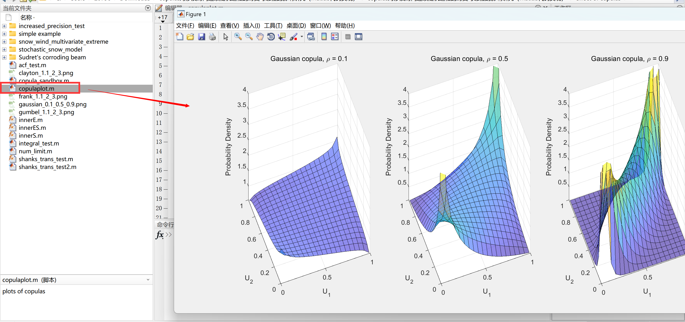
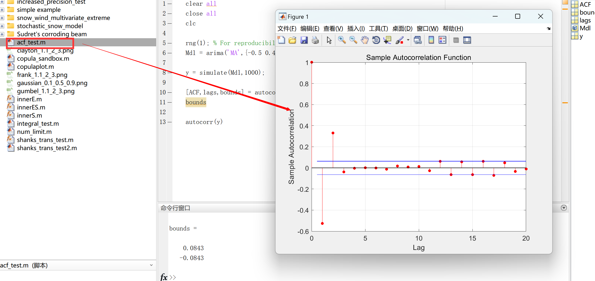
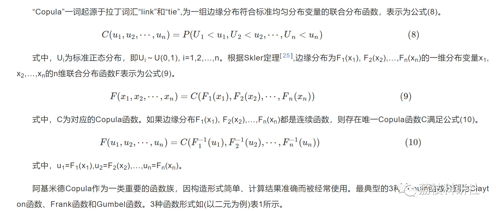
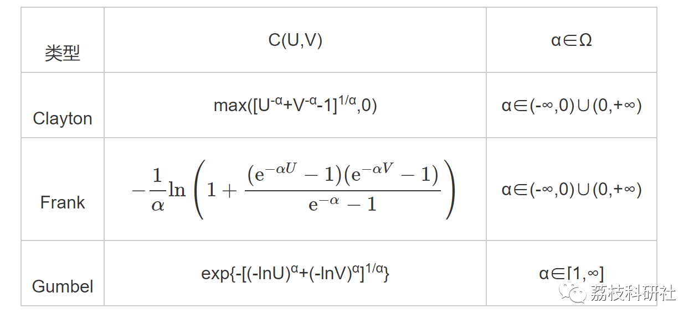
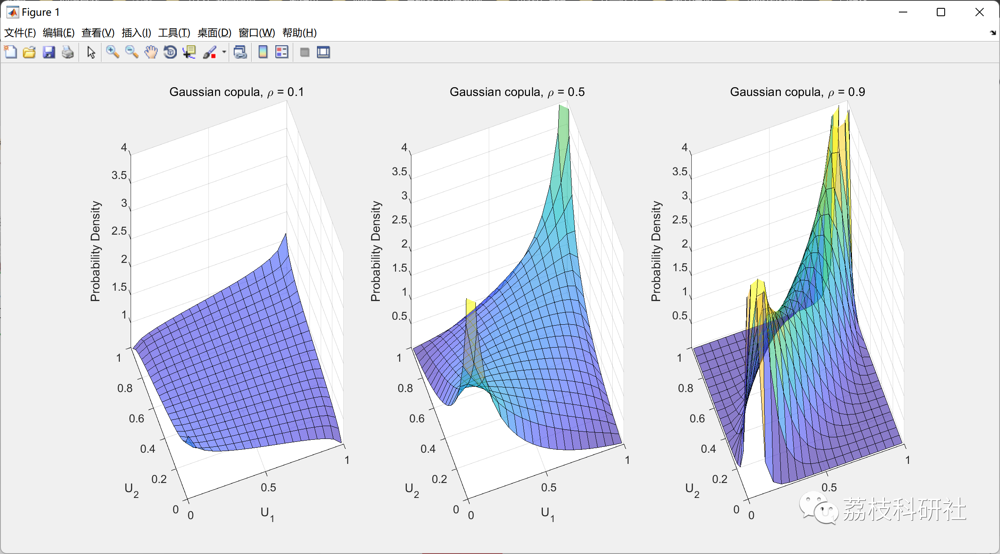
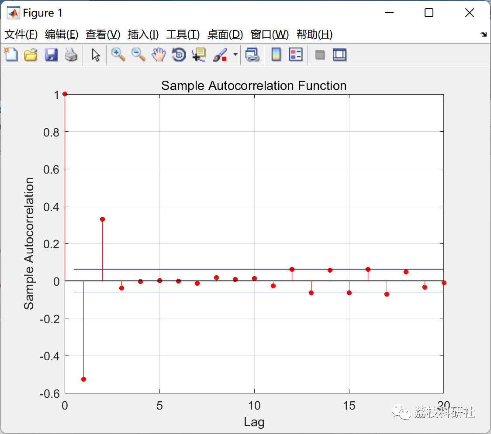
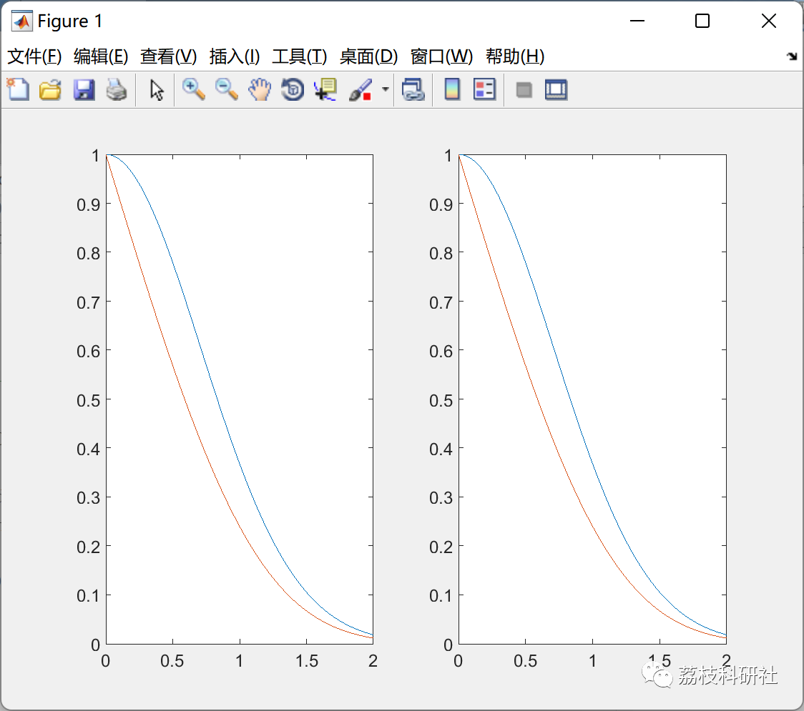
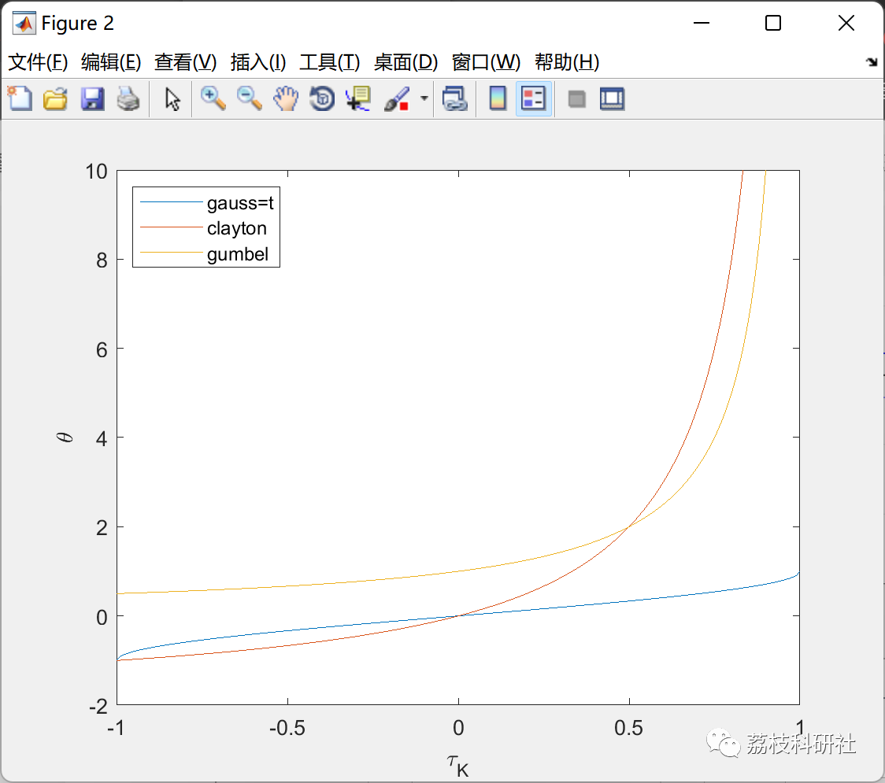
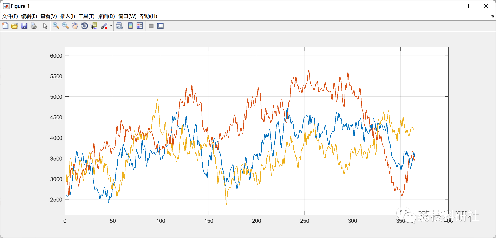
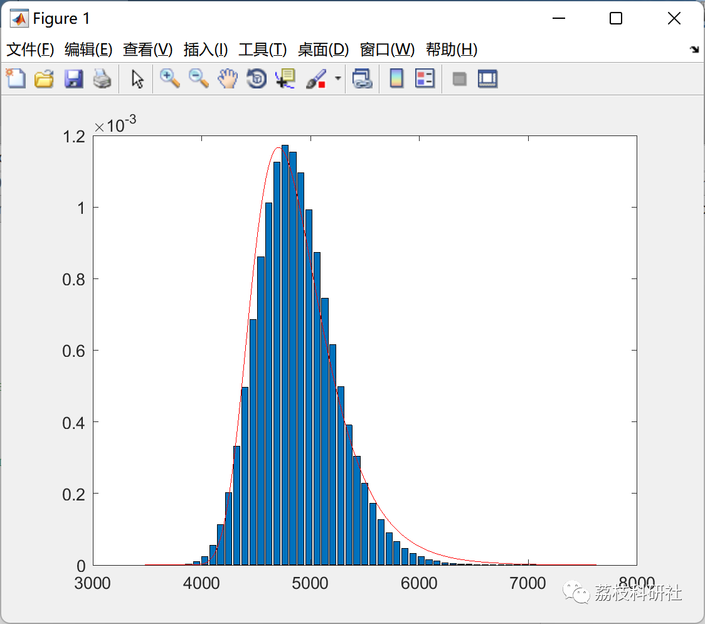

# Study on the impact of copulas on time-varying reliability involving continuous random processes (Matlab code implementation)

💥💥💥💞💞💞 Welcome to this blog❤️❤️❤️ 💥💥💥​
🏆 Bloggers' Advantages: 🌞🌞🌞 The content of the blog strives for rigorous thinking and clear logic to facilitate readers.
⛳️ Mantra: A journey of a thousand miles is begun with a single step.
Litchi Research Society
Code Collection: Power Systems, Intelligent Algorithms and Applications, Neural Network Prediction, Path Planning, Optimized Scheduling, Workshop Scheduling, Image Processing, Signal Processing...
🎁 Special Section Links:
🌈🌈🌈🌟🌟🌟 Electrical Code Intelligent Algorithms and Their Applications Path Planning Neural Network Prediction Optimized Scheduling Image Processing Workshop Scheduling Signal Processing Romantic Her Thoughts Math Modeling Complete Code Matters
\n        \n      \n        \n  
💥1 Overview
For multifunctional mechanical systems, the core of analyzing their reliability lies in establishing the joint distribution function (CDF) of multiple functional characterizations; however, complex correlations make it difficult to construct CDFs conventionally. Copula functions can well describe correlations and establish joint distribution functions for multiple variables.
📚2 Run Results
🎉3 References
[1] Liu Jingyi, Zhuang Xincheng, Zhang Yugang, Pang Huan. Competitive failure analysis method based on Copula functions for multifunctional mechanical systems [J]. Northwestern Polytechnical University Journal, 2022, 40(04):909-917.
[2] He Haoxiang, Cheng Yang, Huang Lei, Chen Wang, Chen Yanjiang. Continuous Beam Bridge Overall Seismic Vulnerability Analysis Based on Multivariate Copula Functions [J]. Beijing University of Technology Journal, 2022, 48(10):1018-1027.
🌈4 MATLAB Code Realization
Click the article's lower left corner to read more.

## Images

<!-- PAYMENT_BLOCK -->

## Get this dataset

- Payment link (Stripe): [Buy now](https://buy.stripe.com/3cs8yP7sY87d0vu9AB)
- Payment QR code: 

<!-- /PAYMENT_BLOCK -->
